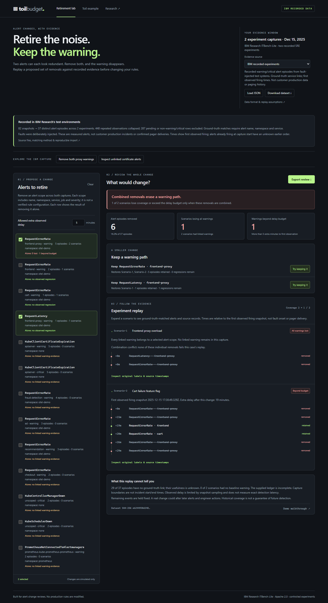

# IBM alert coverage report

**Did expected warnings appear during IBM Research SRE fault experiments?** The main demo audits the public ITBench-Lite alert snapshots against each experiment's declared expected alerts. It distinguishes observed, not observed, and unknown evidence, and links directly to IBM's original ground truth and alert snapshots. This is a practical SRE test-quality report, not IBM production telemetry or evidence that anyone was paged. Related alert and chaos-test tooling already exists; the project does not claim to be the first to solve this problem.


## Run the internship demo

```powershell
python -m venv .venv
.venv\Scripts\python.exe -m pip install -r requirements.txt
.venv\Scripts\python.exe -m api.demo --port 8001
```

Open [the report](http://127.0.0.1:8001/). An existing virtual environment needs only the last command. The report works offline from the checked-in normalized data; Docker, Kubernetes, PostgreSQL, an IBM account, and API keys are unnecessary.

For GitHub Pages, `python scripts/export_pages.py` builds the read-only report in `pages/`. The [Pages workflow](.github/workflows/pages.yml) publishes only that directory on pushes to `main`. GitHub Pages does not run the Flask API; the export includes the verified report JSON as a static file. The original IBM evidence links still point to the pinned public dataset.

The report covers 35 public SRE experiments and their declared alerts. [Method and original source](docs/COVERAGE.md) explains the conservative matching and its limits. Run `.venv\Scripts\python.exe -m ingest.itbench_coverage --download` to re-fetch the pinned source, then run the same command without `--download` to verify checksums and rebuild the normalized report. The earlier alert-retirement replay remains at `/retirement`; the original synthetic toil dashboard remains at `/toil`.

## Earlier alert-retirement experiment

**Can we remove these noisy alerts together without losing the warnings we had for past incidents?** The earlier lab explores that separate SRE change-review problem. Two alerts can each look redundant on their own, while removing both creates a blind spot. The lab replays a batch of removals against a separate incident ledger, exposes lost and delayed warnings, compares individual and combined outcomes, and proposes individual rules to keep.

The earlier replay uses **37 recorded alert episodes from two IBM Research ITBench-Lite experiments**, normalized from 82 snapshots. Removing both frontend-proxy warning scopes removes six episodes, leaves the overload experiment with no ground-truth-linked warning, and delays the cart experiment's first remaining observation by about 19 minutes. Keeping the proxy error-rate scope repairs both outcomes while removing one episode. These are measured alerts from fault-injected test systems, not customer production incidents or confirmed pages. The small evidence sample remains explicitly inconclusive for production safety.



Open the earlier [Alert Retirement Lab](http://127.0.0.1:8001/retirement) after starting the local demo. The original toil dashboard remains at `/toil`, with its original synthetic fixture.

- [Three-minute demo walkthrough](docs/DEMO.md)
- [Research, existing products and the limits of the novelty claim](docs/RESEARCH.md)
- [IBM data provenance, normalization and reproduction](docs/IBM_DATA.md)
- [IBM ecosystem research and proposed integration](docs/IBM_RESEARCH.md)
- [Replay calculations, JSON import format and evidence limits](docs/REPLAY.md)

Load a JSON export through the interface to analyze other histories. Export a review containing the input, selected rules, assumptions, per-incident timelines and dataset fingerprint. Imported files are used for that browser session and do not replace stored data. This tool does not modify production alert rules.

The evidence selector also offers authored synthetic teaching examples. The `/toil` dashboard remains synthetic; IBM alerts do not provide the response-time data required by its effort model. No-regression results apply only to supplied history and are not a guarantee of future safety. Noise reduction, backtesting and counterfactual incident analysis all have prior art; this project makes no worldwide novelty claim.

## Optional original infrastructure stack

Requirements: Docker Desktop with the **Linux engine running**, Docker Compose v2, and Make. No host Python or PostgreSQL installation is required.

```sh
docker compose up
```

In a second terminal, after the app is healthy:

```sh
make seed
```

Open **[Toil Budget](http://localhost:8000)**. A first build downloads images and Python dependencies. Before seeding, the dashboard shows a useful empty state; after seeding, refresh once the 15-second analysis cache expires. `docker compose up -d --build` is the detached alternative.

| Service | Local address |
| --- | --- |
| Retirement lab / original toil dashboard | http://localhost:8000 / http://localhost:8000/toil |
| Grafana, pre-provisioned SRE dashboard | http://localhost:3000/d/toil-budget |
| Prometheus / active alerts | http://localhost:9090/alerts |
| Application metrics | http://localhost:8000/metrics |

On Windows without Make, run `docker compose exec -T app python -m seed.generate --seed 42 --months 6`. Repeated seeding **atomically replaces the demo dataset**, preserving ingestion measurements without duplicating events. The default fixture is April–September 2026 in America/Toronto, independent of today's date; use `--start YYYY-MM-01`, `--months`, `--seed`, and `--timezone` for another window.

```sh
make seed SEED=42 MONTHS=6
make test       # unit/API/config checks + real PostgreSQL integration tests
make check-rules
```

`make test` runs a disposable app container, installs dev dependencies there, creates isolated temporary test databases on the Compose PostgreSQL server, and removes those test databases afterwards. The running app image and demo dataset are preserved. Run `docker compose build app` before this command after changing code. `docker compose down` stops the stack and retains its volumes.

## Original toil analysis

The original `/toil` view estimates repetitive manual work from alert frequency, intervention, repeated remediation and incident associations. Every toil figure is an estimate with explicit assumptions. It remains available alongside the new retirement workflow, using a separate six-month fixture in demo mode.

- `redis_memory_pressure` leads automation recommendations, followed by certificate rotation and disk cleanup for seed 42.
- `worker_queue_depth_warning` leads deletion recommendations, ranked by event volume; a no-action alert can have zero estimated toil and still create considerable noise.
- Runbook repeat rate is visible on every recommendation. No separate automation-confidence score is invented.
- Classification order is **delete → tune → automate → keep_human → unclassified**. Defaults do not guarantee a candidate in every class.
- Dashboard filters, sortable columns, alert detail trends, and runbook breakdowns use the Flask API; there is no frontend framework.

## API

| Endpoint | Response |
| --- | --- |
| `GET /api/coverage/report` | IBM benchmark alert coverage summary and per-experiment evidence links |
| `GET /api/retirement/dataset` | Configured replay evidence; IBM ITBench-Lite by default, `?example=synthetic` for teaching cases |
| `POST /api/retirement/replay` | Proposed removals replayed individually and together; lost/delayed warnings, timelines, evidence gaps, restoration options, dataset hash |
| `GET /api/summary` | Annual toil estimate, event/type counts, classification counts/shares, top-three automation savings, explicit window, model assumptions and thresholds |
| `GET /api/alerts` | All metrics per alert name, sorted by annual toil estimate descending; unknown estimates last |
| `GET /api/alerts/<name>` | Metrics, monthly occurrences including quiet months, manual runbook breakdown; 404 for unknown names |
| `GET /api/recommendations` | Up to three automate candidates and three delete candidates, each with numeric reasons and estimated annual gross savings |
| `GET /healthz` | Liveness independent of PostgreSQL |
| `GET /readyz` | PostgreSQL/schema readiness; 503 on failure |
| `GET /metrics` | Prometheus request latency/count/status, concurrency, durable ingestion timing, DB availability, and analysis gauges |

`alerts_analysed` counts events; classification shares count **alert types**. Unknown estimates are JSON `null`, not zero. An API failure returns a structured JSON error without database credentials or exception details. Results are cached for 15 seconds per replica; large real-world datasets would require a different aggregation strategy.

## Configuration and development

Edit [config/thresholds.yaml](config/thresholds.yaml) for the exact classification thresholds, [config/model.yaml](config/model.yaml) for timezone/business hours and savings assumptions, and [config/slo.yaml](config/slo.yaml) for service objectives. Restart the app after edits. When changing SLOs or Kubernetes configuration, regenerate checked-in artifacts:

```sh
python -m prometheus.generate_rules
python -m grafana.generate_dashboard
python -m k8s.generate_config
```

Local development uses Python **3.11**:

```sh
python -m venv .venv
# Activate .venv using your shell's activation command.
pip install -r requirements-dev.txt
make test-local
python seed/generate.py --seed 42 --months 6 --output seed/events.json
```

To run locally, set `DATABASE_URL` to a reachable PostgreSQL database, then run `flask --app api.app run --port 8000`. Docker uses Gunicorn with **one worker and four threads per replica**; Kubernetes uses two replicas. No authentication, tenancy, external alert integrations, ML, or settings UI is included.

## Repository map

`ingest/` normalizes source data; `analysis/` scores and classifies it; `api/` owns Flask, repositories and instrumentation; `ui/` contains static HTML/CSS/JS; `seed/` is the deterministic CLI. `config/`, `prometheus/`, `grafana/`, and `k8s/` define how the tool itself runs and is monitored. `tests/` verifies formulas, boundaries, ingestion, endpoints, failure behavior and configuration consistency.

Read [MODEL.md](docs/MODEL.md) for formulas and assumptions, [LIMITATIONS.md](docs/LIMITATIONS.md) for blind spots, and [OPERATIONS.md](docs/OPERATIONS.md) for SLOs, diagnosis, metrics, and kind/minikube deployment.

[VALIDATION.md](docs/VALIDATION.md) records the completed checks and the local Docker startup limitation.
