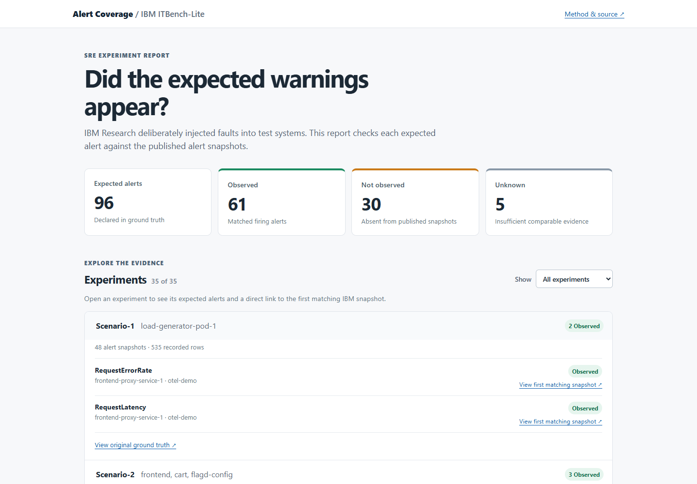

# IBM alert coverage report

I built this project to check whether warnings IBM Research expected during controlled failures appeared in its recorded alerts. [Try the live report](https://jasonx12345.github.io/IBM-SRE-Demo/) or watch the [short walkthrough](https://www.youtube.com/watch?v=Yr1aocCnVc0).

IBM Research's public [ITBench-Lite dataset](https://huggingface.co/datasets/ibm-research/ITBench-Lite) includes 35 SRE fault experiments. Each experiment has a file describing the expected alerts and snapshots of alerts recorded during the test. I wrote code that compares them using the alert name, namespace, and service or pod. It marks each expected alert **observed**, **not observed**, or **unknown**.

The report checks 96 expected alerts: 61 were observed, 30 were not found in the published snapshots, and 5 could not be judged from the available evidence. “Not observed” is a starting point for investigation. It does not prove a monitor failed or a page was missed. The data comes from IBM Research test systems, not IBM production. I do not claim this is a new kind of tool. The [matching method and limits](docs/COVERAGE.md) explain what the results mean.



## Run it locally

Use Python 3.11 or newer:

```powershell
python -m venv .venv
.venv\Scripts\python.exe -m pip install -r requirements.txt
.venv\Scripts\python.exe -m api.demo --port 8001
```

Open http://127.0.0.1:8001/. The demo uses saved data and needs no Docker, Kubernetes, database, IBM account, or API key.

## Check the source data

The importer uses a pinned ITBench-Lite revision. `seed/itbench-coverage/manifest.json` records the source files and checksums. To verify the saved files and rebuild the report, run:

```powershell
.venv\Scripts\python.exe -m ingest.itbench_coverage
```

Add `--download` to fetch the same public source files again. This imports the 35 SRE scenarios' ground truth and alert snapshots; it does not download their metrics, logs, or traces. See [data details](docs/COVERAGE.md) and [IBM attribution](THIRD_PARTY_NOTICES.md).

## The second lab

I also built a local [alert-retirement lab](http://127.0.0.1:8001/retirement). It tests whether removing noisy alerts together would have hidden warnings in two recorded experiments. It uses 37 alert episodes normalized from 82 snapshots. Removing both frontend-proxy warning scopes removes six episodes and leaves the overload experiment with no ground-truth-linked warning. Keeping the proxy error-rate scope repairs both outcomes. This replay is limited to those experiments and does not establish that a live alert rule is safe to remove. [Replay method](docs/REPLAY.md) explains the calculation.

The older, synthetic toil dashboard is at `/toil`. It is separate from the IBM data because that data lacks the human-response fields needed for toil estimates.

## Build and test

GitHub Pages serves a read-only export, not the Flask API. To rebuild the files in `pages/`, run:

```powershell
.venv\Scripts\python.exe scripts/export_pages.py
```

The [Pages workflow](.github/workflows/pages.yml) publishes that folder on pushes to `main`. To run the local tests:

```powershell
.venv\Scripts\python.exe -m pip install -r requirements-dev.txt
.venv\Scripts\python.exe -m pytest -q
```

Database integration tests need a separate PostgreSQL test database. The public demo does not. The older Docker, Grafana, Prometheus, and Kubernetes setup is still in the repository; [operations notes](docs/OPERATIONS.md) cover it.
